# Архитектура ревматологического портала

## 1. Назначение и границы

Портал помогает пользователю заполнить анкету, получить результат скрининга, заметить красные флаги, подготовиться к обращению к врачу и скачать результат в PDF. Библиотека знаний и страница «К какому врачу и с чем идти» дополняют этот маршрут. ИИ поясняет готовый результат и предлагает вопросы к врачу, но не рассчитывает результат и не заменяет медицинскую консультацию.

Этот документ описывает **целевую верхнеуровневую архитектуру**: ответственность компонентов, движение данных и гарантии взаимодействия. Он не утверждает, что все механизмы уже реализованы: текущая реализация находится на стадии каркаса. Политика кеширования и дополнительные требования к надёжности, не закреплённые исходным документом, явно отмечены как предложения.

В ядро MVP входят анкета, результат, PDF, библиотека и маршрут к врачу. ИИ — дополнительный сценарий. Личный кабинет и форум находятся за границами MVP.

## 2. Общая схема и ответственность

Система состоит из независимо развёртываемых сервисов в одном репозитории. Браузер взаимодействует с BFF, а не напрямую с внутренними сервисами, Kafka или хранилищами. Целевая среда развёртывания — Kubernetes.

На обзорной схеме внутренние хранилища и обращения каждого сервиса к IAM опущены; группа предметных сервисов не означает общий процесс или общую БД.

| Компонент | За что отвечает | За что не отвечает |
| --- | --- | --- |
| **Frontend** | Анкета, отображение результата и статусов, библиотека, маршрут к врачу, скачивание PDF, показ пояснения ИИ. | Не принимает окончательных решений о правах и не выполняет доверенный расчёт результата. |
| **BFF** | Единый HTTP API для браузера, отправка команд в Kafka, сбор данных по gRPC, проксирование WSS к AI. | Не владеет предметными данными, не рассчитывает результат и не заменяет проверки доступа в сервисах. |
| **IAM** | Гостевые сессии, выдача и обновление токенов, роли, правила доступа и отзыв прав. | Не хранит ответы анкеты, статьи и PDF как предметные данные. |
| **Screening** | Версии анкеты, ответы пользователя, расчёт и версии результата, красные флаги. | Не делегирует расчёт ИИ и не формирует PDF. |
| **Content** | Библиотека знаний, версии материалов, рецензирование и публикация. | Не рассчитывает индивидуальный результат и не управляет сессиями. |
| **Reporting** | Формирование PDF по определённой версии результата и статус подготовки отчёта. | Не определяет актуальные права пользователя и не выдаёт обходной доступ к файловому хранилищу. |
| **Files** | Метаданные файлов, ограниченный по времени доступ, выдача разрешённого файла из закрытого SeaweedFS. | Не рассчитывает результат и не заменяет IAM собственной копией правил доступа. |
| **AI** | Локальная проекция данных (возможно с доступом к векторной базе данных), поиск по утверждённым материалам, пояснение результата и вопросы к врачу. | Не является источником истины для результата, публикаций или прав доступа. |
| **Kafka** | Доставка команд владельцам и событий подписчикам. | Подтверждение брокера не означает успешного выполнения бизнес-операции. |
| **SeaweedFS** | Хранение содержимого файлов в закрытом контуре. | Наличие файла не даёт пользователю права его скачать. |

### Владение данными

Во всех базах данных портала для идентификаторов записей используется только **UUIDv7** (RFC 9562). Внешние ключи и ссылки в проекциях сохраняют исходный UUIDv7 записи.

У каждого сервиса — свои данные и миграции. Другой сервис получает информацию **события или в конкретных случаях по gRPC или после репликации**, но не читает и не изменяет чужие таблицы напрямую. Это логическая граница владения; конкретная технология и физическое размещение БД здесь не фиксируются.

Проекция — локальное представление чужих данных, обновляемое из событий. Она нужна для определённого сценария чтения, может отставать от источника и не становится новым владельцем исходных данных. Например, AI использует копию результата для пояснения, но исправление результата остаётся ответственностью Screening.

## 3. CQRS: два разных пути данных

**CQRS разделяет обработку изменений и получение данных.** В этой архитектуре команды идут через Kafka, а запросы чтения — синхронно по gRPC. BFF переводит браузерные HTTP-запросы в соответствующий внутренний путь.

| Путь | Назначение | Основной маршрут | Что получает пользователь |
| --- | --- | --- | --- |
| **Команда** | Изменить состояние: например, сохранить ответы или запросить подготовку PDF. | Браузер → BFF → Kafka → сервис-владелец. | `202` и `operationId` после подтверждения Kafka; окончательный исход — отдельно. |
| **Запрос** | Получить анкету, результат, материалы или статус операции. | Браузер → BFF → gRPC владельца → BFF → браузер. | Данные, статус ожидания или ошибку чтения. |
| **Событие** | Сообщить об уже зафиксированном изменении. | БД владельца / outbox → Kafka → заинтересованные сервисы. | Обновление производных данных; это не прямой ответ на HTTP-запрос. |
| **Синхронный IAM** | Выдать или обновить токен, проверить актуальный доступ. | BFF или защищающий ресурс сервис → IAM. | Результат аутентификации или решение о доступе без ожидания очереди. |

Выдача и обновление токенов — сознательное исключение из асинхронного пути изменений. Их нельзя ставить в одну очередь с обычными предметными командами.

### Путь команды

1. BFF принимает запрос и передаёт команду с идентификатором операции и контекстом инициатора в Kafka. У команды есть **один сервис-владелец**.
2. Только после подтверждения брокера BFF возвращает `202` и `operationId`. Это означает «команда принята к обработке», а не «результат уже готов».
3. Владелец проверяет повторную доставку, актуальные права через IAM и бизнес-правила. Проверка доступа при отправке не заменяет проверку при выполнении: за время в очереди права могли измениться.
4. При успехе владелец в одной локальной транзакции сохраняет предметное изменение и событие в outbox. При отказе изменение не применяется; по `operationId` должен быть доступен исход операции.
5. Публикация события и обновление чужих проекций происходят после фиксации изменения, независимо от исходного HTTP-запроса.

Показан успешный путь; издатель outbox включён в ответственность сервиса-владельца. Согласованная фиксация статуса операции вместе с изменением — предлагаемое уточнение механизма надёжности.

### Путь чтения и согласованность

BFF обращается к одному или нескольким сервисам по gRPC и собирает ответ для экрана. Сервис проверяет доступ к защищённым данным и читает свою модель чтения. Обработчики команд и запросов разделены, но **CQRS не требует двух отдельных БД**: обе модели могут находиться в БД одного сервиса.

После `202` клиент узнаёт исход по `operationId`. Для интерфейса нужно различать ожидание, успех и отказ; конкретный перечень статусов закрепляется контрактом. Недоступность проверки статуса — не доказательство, что команда не выполнилась.

Успешная запись у владельца не означает, что все проекции уже обновились. Если сценарию нужна точная версия результата, он обращается к владельцу либо ждёт эту версию в своей проекции. Нельзя молча подменять её предыдущей версией, например при подготовке PDF или пояснения AI.

**CQRS здесь не означает Event Sourcing:** источником истины остаются данные сервисов, а события служат интеграции. Хранение всей предметной истории только как журнала событий не предусмотрено этим описанием.

## 4. Outbox и повторная доставка

Outbox связывает изменение данных с обещанием опубликовать событие **без общей транзакции между БД и Kafka**.

- В одной транзакции сервис сохраняет предметное изменение и запись исходящего события в своей БД.
- Отдельный процесс публикации читает outbox, отправляет события в Kafka и после подтверждения отмечает успешную отправку.
- Если Kafka недоступна, зафиксированное изменение не теряется: событие остаётся в outbox до повторной попытки. Подписчики в это время отстают.
- Если отправка прошла, но отметка о ней не сохранилась, событие может прийти повторно. **Outbox не даёт сквозную гарантию exactly-once.**

Команда выражает намерение, событие — свершившийся факт. Событие об успешном изменении нельзя публиковать до фиксации этого изменения.

### Требования к надёжной обработке

Исходная архитектура требует outbox и защиты от повторного применения команды. Для выполнения этих гарантий предлагается закрепить следующие правила:

| Риск | Требуемое поведение |
| --- | --- |
| Повторная доставка команды | По идентификатору команды владелец распознаёт уже обработанную работу и не применяет изменение второй раз. Учёт обработки и успешный исход согласованы с предметной транзакцией. |
| Повторная доставка события | Подписчик не создаёт повторный эффект; обработка события и продвижение своей проекции согласованы. |
| Запоздавшее событие | Старая версия не перезаписывает новую; удаление также имеет версию и не отменяется старым обновлением. |
| Сбой после фиксации, но до подтверждения обработки | Повтор безопасен благодаря сохранённому исходу, а не только памяти процесса. |
| Временная ошибка | Допускается повтор с контролируемой задержкой; команда не объявляется успешной до фактического выполнения. |
| Некорректное сообщение или устойчивый отказ | Сообщение не зацикливает очередь: нужен отдельный разбор ошибок и видимый исход операции. Конкретная retry/DLQ-политика требует решения. |

Outbox не делает атомарной работу нескольких сервисов. Если Screening зафиксировал результат, а Reporting ещё не создал PDF, результат остаётся доступен, а подготовка отчёта имеет собственный статус и может быть повторена отдельно.

## 5. Кеширование

> **Предлагаемая политика.** В исходной архитектуре кеширование не определено. Ниже описаны его границы, а не уже выбранные Redis/CDN, сроки TTL или готовая реализация.

Кеш — удаляемая копия для ускорения чтения. **Он не является источником истины, хранилищем статусов операций или основанием для разрешения доступа.** Его потеря должна приводить к чтению у владельца, а не к потере предметных данных.

### Где кешировать

| Данные | Допустимый подход | Ограничение |
| --- | --- | --- |
| Общедоступные опубликованные материалы Content | Кешировать опубликованную версию и представления списков; сбрасывать или обновлять их при публикации, изменении и снятии с публикации. | Если материал должен стать недоступен, одного ожидания TTL недостаточно. |
| Версии анкеты | Кешировать содержимое конкретной версии. Указатель на актуальную версию обновлять отдельно. | Ответы и расчёт должны ссылаться на ту версию, которую заполнял пользователь. |
| Результат скрининга | При необходимости — закрытый кеш конкретных идентификатора и версии результата на стороне сервиса. | Проверка актуальных прав обязательна и при попадании в кеш; персональные ответы не попадают в общий публичный кеш. |
| Статус операции | По умолчанию читать у владельца, без дополнительного кеша. | Устаревшее «в обработке» скрывает завершение, а устаревший успех не должен подменять актуальное состояние ресурса. |
| PDF | Использовать уже подготовленный файл, если он соответствует нужной версии результата и параметрам отчёта. | Повторное использование файла не продлевает разрешение и не отменяет новую проверку IAM. |
| Решения IAM | Не использовать устаревшее положительное решение вместо актуальной проверки защищённой операции. | Доступность кеша не разрешает обходить отказ или недоступность IAM. |

### Путь чтения с кешем

1. Запрос приходит через BFF к сервису, отвечающему за данные.
2. Для защищённых данных сервис получает актуальное решение IAM.
3. Сервис ищет разрешённое представление в кеше. Ключ учитывает ресурс, версию и параметры представления; для персональных представлений — также область доступа.
4. При промахе сервис читает свою БД, формирует ответ и при необходимости сохраняет копию. Сбой кеша не должен отменять доступное чтение из основного хранилища.

Для первой версии архитектуры достаточно кеша у владельца данных; общий кеш персональных агрегированных ответов в BFF не требуется. Это уменьшает число мест, где надо учитывать права и инвалидировать копии.

Версионирование защищает от смешивания разных состояний ресурса. События помогают инвалидировать производные представления, TTL ограничивает срок хранения копии. Однако задержка события или неистёкший TTL **не являются разрешением выдать отозванный ресурс**: актуальная доступность проверяется отдельно. Значения TTL и допустимое отставание нужно согласовать по типам данных, а не назначать одинаково для всего приложения.

Проекция AI и векторный индекс — не просто кеш HTTP-ответов: у них есть собственная задача обработки, версии источников и измеримое отставание.

## 6. IAM: идентичность и решение о доступе

IAM централизует аутентификацию и авторизацию. Гость также имеет сессию и ограниченный контекст доступа: отсутствие личного кабинета не означает публичность его анкеты и результата.

**IAM принимает решение, а сервис, выполняющий действие, обеспечивает его соблюдение.** Это разделяет ответственность:

- BFF передаёт проверенный контекст инициатора во внутренний запрос или команду. Идентификатор пользователя из произвольного поля браузерного запроса не считается доверенным.
- Сервис определяет действие и ресурс по собственным данным либо данным доверенного владельца, а не по заявлению клиента о том, кому принадлежит ресурс.
- IAM оценивает актуальные роли и правила. Наличие токена само по себе не заменяет эту проверку.
- Владелец команды проверяет доступ при выполнении. Сервис чтения — перед выдачей защищённых данных. AI — перед использованием контекста и перед выдачей ответа.
- При недоступности IAM защищённая операция **не разрешается** — принцип fail closed. Это техническая недоступность, а не обязательно окончательный бизнес-отказ; политика безопасного повтора задаётся отдельно.

Проверка на входе в BFF полезна, но не является единственной границей безопасности. В частности, команда может ждать в Kafka, а PDF или ответ AI — готовиться уже после изменения прав пользователя.

## 7. PDF: подготовка отдельно, скачивание отдельно

### Подготовка

1. Пользователь запрашивает PDF через BFF. Команда поступает в Reporting через Kafka; интерфейс получает идентификатор операции.
2. Reporting проверяет доступ перед чтением исходных данных и получает у Screening **определённую версию результата**.
3. Reporting формирует PDF. Files отвечает за файловые метаданные и ограниченный доступ, SeaweedFS — за сохранение содержимого в закрытом контуре.
4. Reporting предоставляет статус подготовки. Готовый файл связан с исходным результатом и его версией; новый результат не должен незаметно менять уже сформированный отчёт.

Конкретный внутренний протокол передачи PDF от Reporting в файловый контур здесь не фиксируется. Важно разделение: Reporting создаёт документ, Files управляет его выдачей.

### Скачивание

[Открыть HTML-схему](docs/images/architecture-pdf-access.html). Браузер обращается к показанному BFF по HTTP; Reporting не участвует в новой проверке скачивания.

Files проверяет **актуальные права на исходные данные** и срок разрешения, затем читает разрешённый файл из SeaweedFS. Браузер не получает постоянный прямой доступ в хранилище, позволяющий обойти эту проверку.

Если права отозваны во время генерации, новая попытка скачивания отклоняется, даже когда PDF уже готов. Если истёк TTL разрешения, доступ закрывается, но файл остаётся в SeaweedFS. Политика удаления файлов — отдельное решение. Уже начатая передача может завершиться: отзыв прав не обещает отозвать уже отправленные пользователю байты.

**TTL кеша и TTL доступа к файлу — разные вещи:** первый определяет срок хранения ускоряющей копии, второй — срок действия разрешения.

## 8. AI: события → проекция → проверенный контекст

AI не читает чужие БД и не рассчитывает скрининг. Он получает необходимые данные из событий Screening и Content, поддерживает свою проекцию и использует её для пояснения готового результата.

[Открыть HTML-схему](docs/images/architecture-ai-context.html). Screening и Content объединены только как источники событий. Обратные ответы внутренних API опущены; канал BFF ↔ AI показан отдельно от обновления проекции.

### Подготовка данных

- Screening публикует изменения результата с идентификатором и версией, Content — изменения материалов и их публикации.
- AI применяет события к локальной проекции с учётом версий, включая обновления и удаления.
- Индексатор вычисляет эмбеддинги материалов и обновляет векторный индекс. Изменения проекции можно передавать ему через CDC; CDC — допустимый вариант, а не обязательный механизм.
- Векторный индекс возвращает **кандидатов**, а не гарантированно актуальный и разрешённый контекст. Устаревший поисковый результат не должен возвращать снятый с публикации материал в ответ AI.

### Подготовка ответа

1. Браузер передаёт запрос через WSS-прокси BFF. Запрос относится к конкретному результату и версии.
2. AI ждёт требуемую версию в проекции. Если она ещё не получена, сообщает об ожидании или недоступности, а не поясняет старый результат как новый.
3. AI берёт результат из проекции, ищет материалы в индексе и сверяет найденные версии и статус публикации с проекцией. Перед использованием защищённых данных проверяет актуальный доступ через IAM.
4. Из разрешённого контекста формируется запрос к поставщику LLM. Перед выдачей ответ проверяется, в том числе повторно проверяется актуальный доступ.
5. Через BFF пользователю передаётся проверенный ответ и статус генерации. WSS — транспорт; он не означает, что непроверенные токены LLM сразу попадают в браузер.

Расчёт результата, красные флаги, срочные рекомендации и основной экран работают **независимо от AI**. Недоступность проекции, индекса или LLM не должна превращать готовый результат скрининга в недоступный.

Поставщик LLM находится за отдельной границей обработки данных. **Дополнительное требование к согласованию:** определить допустимый состав передаваемых медицинских и персональных данных, минимизацию контекста и правила хранения до включения этого сценария для пользователей.

## 9. Поведение при сбоях

| Ситуация | Архитектурное следствие |
| --- | --- |
| Kafka не подтвердила приём команды | BFF не сообщает об успешном приёме через `202`. При неопределённом исходе повтор должен быть идемпотентным; отсутствие подтверждения не доказывает отсутствие команды в брокере. |
| Владелец команды временно недоступен | Подтверждённая команда ещё не равна выполненной операции; интерфейс не показывает преждевременный успех. |
| БД владельца отклонила транзакцию | Нет ни предметного изменения, ни исходящего события об успехе. |
| Изменение зафиксировано, Kafka недоступна для публикации | Событие остаётся в outbox, локальные данные сохранены, подписчики отстают. |
| Проекция отстаёт | Сценарий учитывает версию; при необходимости ждёт нужную, вместо выдачи старой как актуальной. |
| Кеш недоступен | По предлагаемой политике чтение обращается к владельцу; IAM при этом не обходится. |
| IAM недоступен или права отозваны | Защищённые действия и новые выдачи данных не разрешаются. |
| PDF или AI не готовы | Готовый результат Screening остаётся самостоятельным; дополнительный сценарий имеет собственный статус. |

Для эксплуатации предлагается наблюдать не только доступность процессов, но и **возраст необработанных команд, задержку outbox и проекций, время подготовки PDF, ошибки IAM и генерации AI**. `operationId` и идентификаторы сообщений должны связывать этапы одной операции. Ответы анкеты, содержимое PDF и полный контекст LLM не следует включать в обычные технические логи.

## 10. Контракты и открытые решения

Границы сервисов закрепляются контрактами, а не доступом к общим таблицам или общим предметным моделям.

| Интерфейс | Источник контракта |
| --- | --- |
| Браузер → BFF | OpenAPI, получаемый из API BFF. |
| Синхронные внутренние вызовы | Protobuf / gRPC в [contracts/grpc](contracts/grpc/README.md). |
| Команды на изменение | Protobuf в [contracts/commands](contracts/commands/README.md). |
| События об изменениях | Protobuf в [contracts/events](contracts/events/README.md). |
| Генерация AI через WSS | JSON Schema сообщений и статусов. |

У команд нужны идентификаторы сообщения и операции, версия схемы и контекст инициатора. У событий — идентификатор события, источник, идентификатор и версия сущности. Статус операции должен быть доступен через контракт владельца; BFF не должен угадывать его по наличию сообщения в Kafka.

Сервисы могут использовать разные языки. Клиенты и типы генерируются из зафиксированных версий контрактов. Общие технические библиотеки допустимы, но бизнес-правила и модели хранения остаются у владельцев.

До реализации соответствующих механизмов нужно отдельно закрепить:

- технологию кеша, TTL по классам данных и правила снятия публичного материала с выдачи;
- жизненный цикл статусов операций, сроки хранения результатов дедупликации и безопасный повтор после неопределённого исхода;
- retry/DLQ-политику, правила порядка событий и восстановление проекций;
- матрицу ролей и действий, сроки гостевых сессий, токенов и разрешений на файлы;
- сроки хранения и удаления анкет, отчётов, проекций и данных генерации;
- ограничения LLM-контекста, проверки ответа, допустимые задержки и эксплуатационные пороги.

Эти решения уточняют архитектуру, но не меняют её основную границу: **владелец изменяет данные; Kafka переносит команды и факты; gRPC обслуживает чтение; IAM решает вопрос доступа; кеши, проекции, PDF и AI остаются производными от авторитетных данных.**
